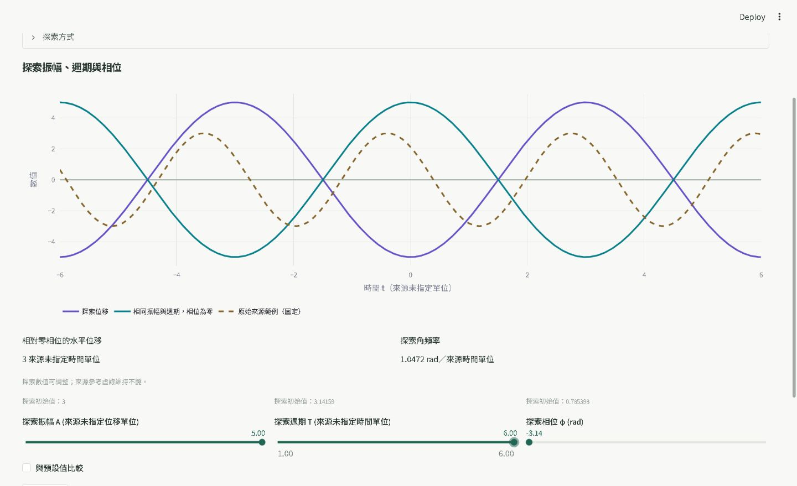
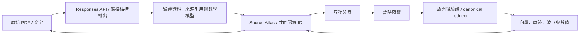

# Visual Learning Lab

### 把教材變成可以探索的理解空間

讀一段公式，和親手改變它，是兩種不同的理解方式。Visual Learning Lab 把
PDF／文字轉成有來源支持的學習表示：從原頁選一個概念，操作模型，觀察圖形
和數值，再回到沒有被探索值改寫的教材。

**[開啟正式應用程式](https://visual-learning-lab-kdemsgmw3swykt5zpqbkc5.streamlit.app/)**
· [3 分鐘展示](docs/day30/DEMO_SCRIPT.md)
· [Day30 實測與發布狀態](docs/DAY30_EVIDENCE.md)
· [30 天正式文章](https://ithelp.ithome.com.tw/users/20184158/ironman/9852)
· [Day1–30 專案導覽](docs/day30/SERIES_INDEX.md)



*實際 Streamlit 介面截圖，非概念稿。這張圖來自本機正式入口的離線驗收；
Cloud 驗收另列於證據文件。教材：MIT OCW / Peter Dourmashkin，CC BY-NC-SA 4.0。*

## 免登入，先動手探索

首頁有兩份已準備好的非商業教學示例，一次點擊載入；不需帳號、OpenAI key
或新的模型請求。Cloud 是否已部署本版，以 [發布證據](docs/DAY30_EVIDENCE.md) 為準。

| 示例 | 可以做什麼 | 來源與界線 |
|---|---|---|
| **簡諧運動** | 調 A／T／φ，看波形、水平位移與角頻率，對照固定來源虛線，重設探索 | MIT Chapter 23；沿用既有人工核准分析。來源未指定位移／時間單位，不能冒稱公尺／秒。此正弦模型使用滑桿，沒有虛構拖曳錨點。 |
| **拋體運動** | Source 第4頁 Figure 5.3 選 vx0，開互動分身，拖曳初速度向量並放開，觀察軌跡與正式數值，再返回原頁 | MIT Chapter 5；**Day26 封存衍生、重新驗證版**。原始 PDF、公式與 ID 保留；新增的來源／假設分類有[明確紀錄](prepared/projectile/PROVENANCE.md)。示範初值不是原圖的數字。 |

本版維持 `VLL_LIVE_AI=""`。自行上傳／貼文分析的程式仍保留，但公開新分析
等待登入、持久帳本與獨立 release gate；首頁將該區收起，沒有假裝可用的生成
入口。Google/OIDC、限額工程存在，不等於真實公開付費生成已驗收。

## 看一次完整的來源往返

**90 秒：** 開拋體 → Source 選初速度分解 → 選 Initial horizontal velocity →
開啟互動分身 → 拖曳向量端點並放開 → 看已提交數值與路徑 → 返回支持來源。
若初次選焦點跳到第6頁，使用來源軌跡按鈕回 Figure 5.3。生成／編譯不是這
90 秒的一部分，也不是測得的初學者完成保證。

**3 分鐘：** 先用約45秒展示 harmonic 三個參數，再用拋體完成上述往返，
最後指出未支援的 Horizontal position 沒有假反解，以及原頁不會跟著探索值
改變。[逐段腳本與60秒備援](docs/day30/DEMO_SCRIPT.md)。

## 產品如何運作



模型產生的是不可信宣告；固定引擎檢查後才呈現。操作以共同 ID 找到真正
擁有參數的表示，經安全反解更新原有狀態。來源 PDF、文字與定位框不隨探索
改變。這個可核對的操作循環，是產品超出文字問答的實作重點。

- **四個視角，同一份教材：** Learn／Source／Explore／Practice。繁中介面、英文選項；生成內容保留分析時的語言，原文不被翻譯成假證據。
- **獨立學習結構：** Flow、Concept Map、Comparison、課程與測驗；Relationships 不冒充所有圖型。測驗、錯誤佇列與導覽在本機，Focused Review／Explain 是另外明確且可快取的 AI 動作。
- **可追溯來源：** Source Lens 原頁、估計的 Source Atlas、可選原生文字 geometry；page-only 支持不捏造框。PDF 分析最多八個文字頁；沒有 OCR。
- **有界互動：** Numeric Lab、安全 arithmetic AST、有限機率集合、平面 Spatial World、可選動態模擬與學習表示規劃。不是通用任意程式執行器。
- **安全直接操作：** 既有 circular／polar／affine 反解、revision／material／token guards、release-to-commit、越界原子拒絕。不能安全反解的量仍可查來源，沒有假 handle。

主要模組：`app.py` 組合介面；`interactive_lab.py`／`safe_math.py` 負責數值
實驗；`scene/` 與 `scene/world/` 負責宣告、驗證、投影與正式狀態；
`source_atlas/`／`source_lens.py` 負責來源；`manipulation/` 負責離線 JSXGraph
操作；`workspace/` 連結四個視角與 Grounded Twin；`prepared_demo.py` 校驗封裝
資產。Python、Streamlit、OpenAI Responses、Structured Outputs、NumPy、Plotly、
Graphviz、pypdf、PDFium 是現有技術組合。此次沒有新增生產依賴或重寫引擎。

## 證據強度與已知限制

| 階段 | 有保存的結果 |
|---|---|
| Day26 | 真實 MIT PDF、實際 pointer 拖曳與來源往返；第一次生成失敗及 observer 計數限制均保留。[證據](docs/DAY26_EVIDENCE.md) |
| Day27 | 初始人工語意 4 PASS／4 PARTIAL／2 FAIL；follow-up 5／5／0，包含沿用分配，**不是未碰過的獨立 holdout**。[人工核准紀錄](docs/day27/post_fix/human-approved-completion.md) |
| Day28 | 五種 Codex 瀏覽器模擬，**不是五位學生**。owner 另回報兩位學生正向非正式印象，未形成正式研究或學習增益數據。[紀錄](docs/DAY28_EVIDENCE.md) |
| Day29 | 當時完整回歸 515／515。[證據](docs/DAY29_EVIDENCE.md) |
| Post-Day29 | 原限額公開工程 548／548；後續 Cloud-fix 本機紀錄 553／553。不同階段，不能相加。[原階段證據](docs/public-release/EVIDENCE.md) |
| Day30 | 最終聚焦 **110／110**、整合回歸 **562／562 PASS**，零真實 provider 呼叫。較早的失敗與54項修復重測分開保留。[全部證據與 Cloud 狀態](docs/DAY30_EVIDENCE.md) |

現有真實案例不證明所有 PDF 都會被正確理解。數學一致性不保證語意 fidelity；
Atlas 框與來源連結可能錯。Harmonic 沒有安全的波形拖曳；Projectile 的封存
Numeric Lab 是獨立唯讀視圖，不能宣稱它隨 World 同步。窄版瀏覽器檢查不是
真機觸控或完整無障礙認證。session 狀態不是永久儲存；重載可能回首頁。

沒有受控真人學習成效證據，也沒有執行本版與 ChatGPT 的並列比較。
[公平比較協定](docs/day30/FAIR_COMPARISON.md) 允許 ChatGPT 使用合理追問與
視覺化工具，不填假分數。[Human × ChatGPT × Codex 決策回顧](docs/day30/DEVELOPMENT_DECISIONS.md)
記錄如何修正零高度、來源固定值與探索控制的錯誤假設。

## 安全、授權與本機啟動

AI 不產生可執行 Python／JavaScript／HTML。嚴格 schema、AST allowlist、
引用白名單、DAG、數值／影格／payload／cache bounds 與實際變更 recheck 保護
引擎。prepared 只從固定、hash 校驗且重新驗證的資產載入；不擴大公開使用者
的 PDF 上傳額度。現有公開限額政策與 OIDC 不變，USD10 終身政策不在本版啟用。

使用 **Python 3.12**，從 repository root 執行：

```powershell
python -m pip install -r requirements.txt
python -m streamlit run app.py
```

準備示例不需金鑰。不要提交 `.streamlit/secrets.toml`。Graphviz 使用 DOT，
不需系統 `packages.txt`；離線 JSXGraph／Plotly 不需 Node build 或 CDN。
可選 parser 使用 `requirements-documents.txt`。完整測試使用獨立測試環境：

```powershell
python -m pip install -r requirements-test.txt
python -X utf8 -B tools/day30_verify.py focused
python -X utf8 -B tools/day30_verify.py full
```

測試工具阻擋真實 provider 並還原舊測試寫出的歷史報表。AppTest 不是瀏覽器
拖曳證據。[公開政策](docs/public-release/POLICY.md)／[部署門檻](docs/public-release/DEPLOYMENT.md)。

MIT OCW 教材採 **CC BY-NC-SA 4.0**，本展示限非商業使用，保留 attribution、
license 連結與適用 ShareAlike 條件；原始素材與新增 UI／模型註記清楚區分，
不暗示 MIT 背書。[完整來源與第三方 notices](THIRD_PARTY_NOTICES.md)／
[reuse ledger](docs/OPEN_SOURCE_REUSE_LEDGER.md)。repository 尚無根目錄的軟體
LICENSE 授權聲明，不能因教材來自 MIT 就推定程式採 MIT license。

生產 raster 使用 pypdfium2／PDFium；保留完整 wheel notices。PyMuPDF 僅供測試
fixture，不部署 `requirements-test.txt`，歷史分發義務仍需各自處理。測試通過
不等於法律審查完成，商業部署與二進位再散布仍需另行 review。

## 下一步

更密集且可人工核對的來源—操作連結、陌生教材的獨立評估、真正的學習研究、
真機鍵盤／觸控可用性，以及 Timeline／Analogies／Image Breakdown／更豐富3D。
公開付費生成必須先完成獨立外部驗收；準備示例不替它背書。
